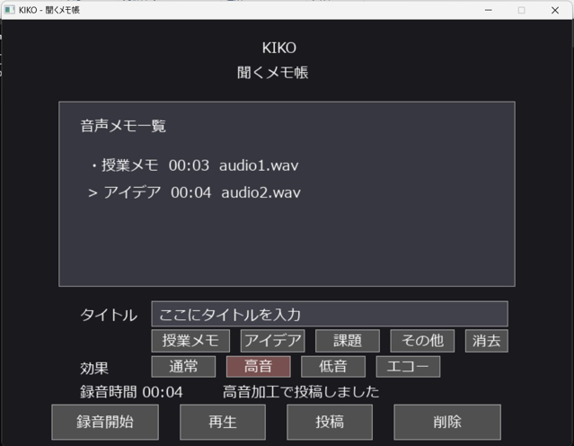

# KIKO — 聞くメモ帳 🎙️

**「書く」だけでなく、「聞く」ことで振り返る。**

KIKOは、C言語とSDL2を使用して個人開発した、Windows向けの音声メモアプリケーションです。授業内容やアイデアなどを声で記録し、タイトルを付けて保存・再生できます。高音・低音・エコーといった音声効果も備えています。

> **開発形態：** 個人開発  
> **主な技術：** C / SDL2 / SDL2_ttf / WAV / MSYS2（Windows）  
> **状態：** Windows上の実際のアプリ画面を掲載しています。すべての機能・環境での動作検証を保証するものではありません。

## 📸 アプリ画面



録音済みのメモ一覧、タイトル入力、カテゴリ選択、音声効果の切り替え、録音・再生・投稿・削除を1画面から操作できます。

## 💡 開発背景

文字入力だけでは記録しにくい内容を、音声で手軽に残して聞き返せる仕組みを作りたいと考え、開発しました。録音から保存、一覧管理、再生までを1つの画面から操作できることを目指しました。

## ✨ 主な機能

| 機能 | 内容 |
| --- | --- |
| 音声録音 | マイク入力を録音。最大300秒で自動停止・保存 |
| WAV保存・再生 | 録音データをWAV形式で保存して再生 |
| メモ一覧 | タイトル・録音時間・ファイル名を一覧表示。最大5件を管理 |
| タイトル入力 | 自由入力・貼り付け、または「授業メモ」「アイデア」「課題」「その他」から選択 |
| 音声効果 | 通常・高音・低音・エコーを選択し、プレビューや保存データに反映 |
| メモ削除 | 一覧から選択したメモとそのWAVファイルを削除 |
| データの読み込み | `memo_list.txt` に一覧情報を記録し、次回起動時に読み込み |
| 録音時間表示 | 録音経過時間を画面に表示 |

### 操作の流れ

1. 必要に応じてタイトルを入力し、音声効果を選択します。
2. 「録音開始」をクリックし、マイクから音声を録音します。
3. 「録音停止」で録音を終了します（上限300秒）。
4. 「再生」で音声効果を適用したプレビューを確認します。
5. 「投稿」でメモ一覧に保存します。
6. 一覧からメモを選び、再生または削除します。

※「投稿」はアプリ内のメモ一覧への登録を指し、インターネットへのアップロードではありません。

## 🛠 使用技術

| 分類 | 技術 |
| --- | --- |
| 開発言語 | C |
| GUI・イベント処理・音声入出力 | SDL2 |
| 文字表示 | SDL2_ttf |
| 保存形式 | WAV（PCM）・テキストファイル |
| 開発環境 | Windows / MSYS2 UCRT64 / VS Code |

## ⚙️ 仕組み

```text
マイク入力
   ↓ SDL2の録音コールバック
音声バッファ（メモリ）
   ├── 録音停止 → recorded.wav（一時的な録音保存）
   ├── 音声効果処理 → preview.wav → プレビュー再生
   └── 音声効果処理 → audio*.wav → メモ一覧に登録
                                          ↓
                               memo_list.txt に管理情報を記録
                                          ↓
                               次回起動時に一覧を復元
```

- `AudioBuffer` 構造体で録音データ、長さ、容量、音声形式を管理します。
- WAVのヘッダーを自分で書き込み、音声サンプルをファイルに保存します。
- 高音はサンプルの間引き、低音はサンプルの繰り返しで表現します。
- エコーは遅延させたサンプルを元の音声に加算して表現します。
- 再生時にはサンプル振幅を増幅し、16bit符号付き整数の範囲に収める処理を行います。

## 🔍 技術的に工夫した点

### 1. C言語による音声データの管理

録音コールバックから得た音声データをバッファに蓄積し、WAV形式で保存できるようにしました。ファイルのヘッダー構造やバッファ管理を自分で扱うことで、音声処理の仕組みを学びました。

### 2. 音声効果の実装

音声データのサンプル列に直接処理を加え、高音・低音・エコーを実装しました。外部の音声加工サービスを利用せず、C言語によるサンプル操作で表現しています。

### 3. 日本語タイトルと一覧管理

SDL2_ttfによる日本語表示、UTF-8文字列への対応、定型タイトルボタン、クリップボード貼り付けを取り入れました。また、音声ファイルとメモ一覧を別々に管理し、アプリの再起動後にもメモを読み込めるようにしました。

## 🧩 開発中の課題と対応

| 課題 | コード上の対応 |
| --- | --- |
| 日本語の表示 | SDL2_ttfでフォントを読み込み、UTF-8の文字列を描画 |
| 再生音量の調整 | サンプル振幅を増幅し、オーバーフローを避けるため値を制限 |
| 録音・保存の管理 | 録音状態を管理し、録音停止後のWAV保存とメモ一覧への登録を分離 |
| Windows環境でのSDL2起動 | `SDL_MAIN_HANDLED` と `SDL_SetMainReady()` を使用 |

### 特に苦労したこと：SDL2の環境構築とコンパイル

本アプリの開発で特に苦労したのは、Windows上でC言語からSDL2を利用するための環境構築です。

MSYS2 UCRT64を使って開発を進める中で、ライブラリの導入やコンパイル・リンクの設定がうまくいかず、アプリを正常に起動できない問題に直面しました。

特に、`WinMain` が未定義となるリンクエラーへの対応に苦労しました。そこで、エラーメッセージを基に原因を調査し、`SDL_MAIN_HANDLED` の定義や `-mconsole` オプションの指定など、SDL2の起動処理とリンク設定を見直しました。

また、ライブラリの参照設定を簡単に管理できるよう、`pkg-config` を導入し、SDL2とSDL2_ttfのコンパイル・リンクに必要なオプションを取得できるようにしました。

この経験を通じて、初めて扱う技術でも、エラーを一つずつ分析し、原因を切り分けながら解決することの重要性を学びました。

## 🚀 実行方法（Windows）

### すでにビルドされた実行ファイルを使う場合

1. `kiko.exe`、`SDL2.dll`、`SDL2_ttf.dll` を同じフォルダに配置します。
2. 有効な日本語フォント `NotoSansJP-Regular.ttf` を同じフォルダに配置します。フォントがない場合は、コード上ではWindowsの `C:/Windows/Fonts/meiryo.ttc` にフォールバックします。
3. マイクを利用できる環境で `kiko.exe` を起動します。

### ソースコードからビルドする場合

MSYS2 UCRT64環境で、Cコンパイラ、SDL2、SDL2_ttf、pkg-configを利用できるようにしてください。必要なパッケージの例：

```bash
pacman -S --needed mingw-w64-ucrt-x86_64-gcc mingw-w64-ucrt-x86_64-SDL2 mingw-w64-ucrt-x86_64-SDL2_ttf mingw-w64-ucrt-x86_64-pkgconf
```

`main.c` のあるフォルダで：

```bash
gcc main.c -o kiko.exe $(pkg-config --cflags --libs sdl2 SDL2_ttf) -mconsole
./kiko.exe
```

> **注意：** 添付ZIPに含まれる `NotoSansJP-Regular.ttf` は0バイトでした。フォントファイルを別途正しく用意するか、Windowsのメイリオを利用してください。また、上記の環境構築・ビルド手順はこの環境で実行検証していません。

## 📁 ファイル構成（提供されたZIP）

```text
kiko-main/
├── main.c               # アプリ本体
├── kiko.exe             # Windows実行ファイル
├── SDL2.dll             # SDL2ランタイム
├── SDL2_ttf.dll         # 文字表示用ランタイム
├── NotoSansJP-Regular.ttf # フォント（ZIP内は0バイト）
├── memo_list.txt        # メモ一覧の保存先
├── recorded.wav         # 録音データ
└── preview.wav          # 音声効果のプレビュー
```

録音内容を公開したくない場合、`recorded.wav`、`preview.wav`、`audio*.wav`、`memo_list.txt` はGit管理から除外することを推奨します。

## 📈 今後の改善

- 音声メモの登録上限（現在5件）の拡張
- 日本語タイトルの入力体験の改善
- 翻訳や文字起こし機能の検討
- 動作確認手順・ビルド環境の整備
- 録音・再生などのテストの追加

## 📌 この開発を通じて

C言語でGUIと音声入出力を組み合わせる中で、イベント処理、メモリ上のデータ管理、ファイルの保存・読み込み、音声サンプルの加工について実践的に取り組みました。今後は使いやすさと保守性を高め、改善を続けていきます。
